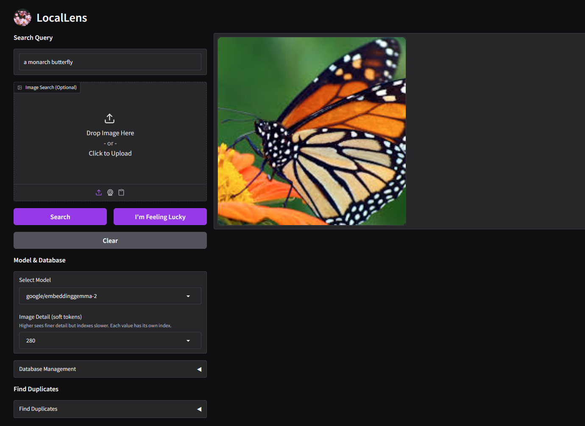

<p align="center">
  <a href="README.md">English</a> |
  <a href="docs/translations/zh/README.md">简体中文</a>
</p>

<h1 align="center">
  <br/>
  LocalLens
</h1>

<p align="center">
  
  
  
  
</p>

<div align="center">
An offline visual search engine for local image and video collections. Indexes directories into ChromaDB using vision embedding models to enable natural language queries and reverse image search, with added duplicate detection.
</div>

<br/>

<div align="center">
  
</div>

---

## Quick Setup

### 1. Download

- **Portable Package (Recommended):** Download the portable build from [Releases](https://github.com/meangrinch/LocalLens/releases/tag/portable).
  - Windows: No requirements.
  - Linux / macOS: Requires Python 3.11+ and Git.
- **From Source:**
  ```bash
  git clone https://github.com/meangrinch/LocalLens.git
  cd LocalLens
  python -m venv venv
  .\venv\Scripts\activate # or source venv/bin/activate (Linux/macOS)
  pip install torch==2.14.1+cu130 torchvision==0.29.1+cu130 --extra-index-url https://download.pytorch.org/whl/cu130 # or pip install torch==2.14.1 torchvision==0.29.1 (macOS)
  pip install -r requirements.txt
  ```

*For additional information, see [Installation](docs/INSTALLATION.md).*

### 2. Index

- **Web UI:** In Database Management, enter a directory path and click Add Folder.
- **CLI:**
  ```bash
  python build_db.py --model_path "google/embeddinggemma-2" --db_path "img_db/embeddinggemma_2" --add "path/to/images"
  ```
- **Sync Changes:** Click Update/Sync in the Web UI, or pass `--update` via CLI to rescan indexed folders for additions or deletions.
- **Image Detail (EmbeddingGemma 2):** Pick an Image Detail level from 70 to 1120 soft tokens below Select Model (default 280). Higher values see finer detail but index slower. Each value keeps its own index, so add your folders again after changing it. Via CLI, add `--max_soft_tokens 140` with a matching `--db_path` such as `img_db/embeddinggemma_2_140`.

### 3. Search

- **Text Search:** Enter a description (e.g., "a monarch butterfly") to retrieve matching media ranked by similarity. Enable Live Search in Advanced Parameters to update results as you type.
- **Reverse Image Search:** Upload an image to find visually similar files, or combine text and image inputs to refine results.
- **Find Duplicates:** In Find Duplicates, choose a Folder to Scan and set the Similarity Threshold, then review the pairs in the Duplicate Inspector tab.
- **Access Restriction (Optional):** By default, the Gradio gallery can display images from any indexed directory. Set `LOCALLENS_ALLOWED_PATHS` in your environment to restrict accessible directories.

---

## Features

- **Indexing**: Recursive directory indexing and incremental sync (ChromaDB)
- **Search**: Natural language text, image, and combined text + image queries
- **Reverse Search**: Find visually similar media from an uploaded image
- **Duplicates**: Locate duplicate and near-duplicate image and video pairs by similarity threshold
- **Models**: Vision embedding backbones (EmbeddingGemma 2, SigLIP 2)
- **Formats**: Image and video support (jpg, png, webp, mp4, mkv, etc.)
- **Interfaces**: Web UI (Gradio) and CLI

---

## Documentation

- [Hardware Requirements](docs/HARDWARE_REQUIREMENTS.md)
- [Installation](docs/INSTALLATION.md)

---

## Support the Project

LocalLens is open-source and free. If it saves you time finding photos or cleaning up duplicate images, consider supporting its development!

<p align="center">
  <a href="https://ko-fi.com/grinnch" target="_blank">
    
  </a>
</p>

---

## License & Credits

- License: Apache-2.0 (see [LICENSE](LICENSE))
- Author: [grinnch](https://github.com/meangrinch)
- Inspired by: [Where's My Pic?](https://github.com/Om-Alve/Wheres_My_Pic) by [Om-Alve](https://github.com/Om-Alve)

<details>
<summary><b>ML Models and Libraries</b></summary>

- EmbeddingGemma 2: [Google](https://huggingface.co/google/embeddinggemma-2)
- SigLIP 2 SO400M (384): [Google](https://huggingface.co/google/siglip2-so400m-patch14-384)
- SigLIP 2 SO400M (512): [Google](https://huggingface.co/google/siglip2-so400m-patch16-512)
- SigLIP 2 Base: [Google](https://huggingface.co/google/siglip2-base-patch16-224)
- ChromaDB: [Chroma](https://github.com/chroma-core/chroma)

</details>
